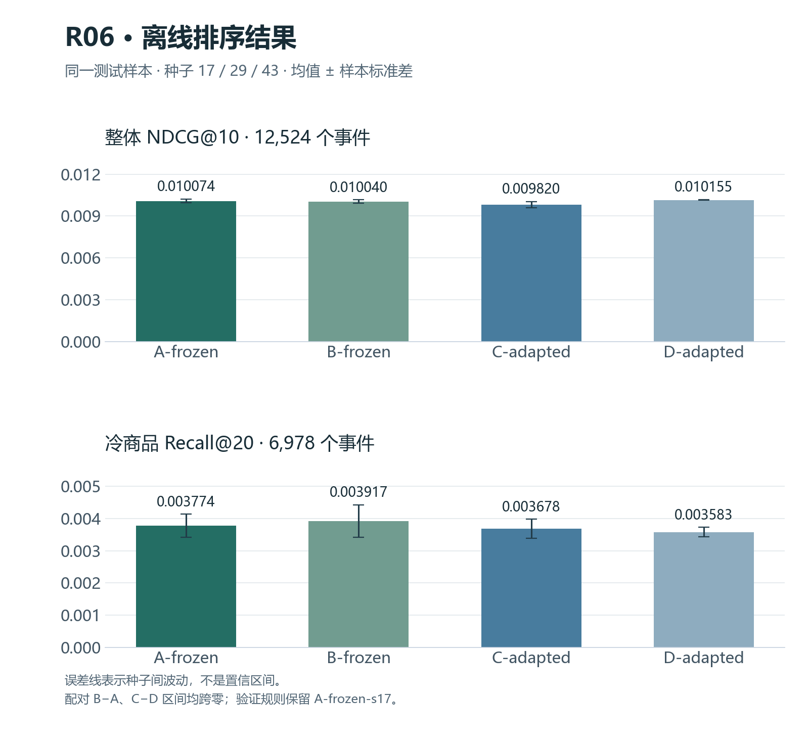

# EvoRec

**简体中文** | [English](README_EN.md)

[](https://github.com/Die4U23/EvoRec/actions/workflows/service-integration.yml)
[](https://github.com/Die4U23/EvoRec/tree/learning-demo-20261014)
[](LICENSE)

一个围绕动态商品库冷启动问题的推荐学习项目，把离线召回与排序实验、FastAPI 推荐服务、PostgreSQL 持久化和真实故障验证放进同一条请求链路。

当前交付为 **本地推荐 Demo + R01–R06 离线实验**。学习版已冻结在 [`learning-demo-20261014`](https://github.com/Die4U23/EvoRec/tree/learning-demo-20261014)（`f6e2916`）；不是生产服务或完整研究 PRD 的完成声明。

[代码导读](docs/learning-guide.md) · [架构与实现](docs/10-architecture-and-implementation.md) · [启动指南](ops/demo-quickstart.md) · [R06 实验报告](docs/experiments/r06-multi-interest/report.md)

## 核心能力

- **推荐与反馈闭环**：示例/新用户、商品详情、收藏、隐藏、撤销与会话重置；后续推荐使用更新后的历史与资格过滤。
- **可追溯请求**：绑定会话、商品包、模型与历史快照，持久化请求及结果；同一幂等键重放原结果，输入冲突明确拒绝。
- **商品生命周期**：CSV/JSON 导入、逐行校验、后台构建、预览、人工发布、下架与回滚。
- **真实模型接入**：批准的 R06 冻结包使用 CF + 内容召回及残差排序；新品演示使用独立内容基线，两条路径明确区分。
- **执行与恢复约束**：有界 CPU 排名队列、持久执行归属、租约及取消清理，覆盖重启、断连和实际进程崩溃。
- **实验与结果管理**：固定输入策略对比、后台任务、标注快照评估、分组指标与 JSON 导出；研究记录保留负结果和不确定性。

## 架构

```text
浏览器 / HTTP 客户端
         │
         ▼
     FastAPI ──────────► 会话 / 反馈 / 商品管理
         │                         │
         ▼                         ▼
  Recommend.execute           PostgreSQL
         │                   请求、结果、版本、任务
         ▼                         ▲
  捕获可信快照 → 召回与排序 → 合法性过滤 / Top-K
                     │
           ┌─────────┴──────────┐
           ▼                    ▼
   新品内容基线             冻结 R06
   标题/类别表示            CF + 内容 + 排序器

后台 worker：catalog / comparison / evaluation
```

`domain` 定义规则，`application` 编排用例，`infrastructure` 适配数据库与模型；离线研究代码位于 `src/evorec/research/`。调用链、事务边界与表关系见[代码导读](docs/learning-guide.md)。

## 已验证结果

### 学习版工程验收

以下为 **2026-10-14、提交 `f6e2916`** 的本机验收，不是本次 README 修改重新跑出的结果。

| 场景 | 结果 | 证据 |
| --- | --- | --- |
| 入口与依赖回归 | 服务/Demo 101 项 + NumPy 4 项通过，无失败或跳过 | [冻结验收摘要](docs/validation/learning-freeze-20261014.json) |
| 完整 R06 双并发 | 两轮各 120/120 成功，0 次 504 | [固定分母与配置](docs/validation/learning-freeze-20261014.json) |
| 恢复与清理 | 重启、同键重放、断连、崩溃恢复，以及自有 PID/端口/schema 清理通过 | [冻结验收摘要](docs/validation/learning-freeze-20261014.json) |
| 页面与退出 | 本轮 catalog 页面冒烟；完整管理/R06 浏览器、Ctrl+C 与备份恢复按源码等价继承此前证据 | [交付记录](docs/validation/learning-delivery-20261013.md) |

完整批准包包含 **137,249 件商品**，使用 NumPy 2.1.3、单排名 worker、并发 2、原 2 秒 API 期限；关闭服务插桩，不自动重试。

| 固定负载轮次 | 成功 / 请求数 | 全部请求客户端 p95 |
| --- | ---: | ---: |
| r1 | 120 / 120 | 1,865.940 ms |
| r2 | 120 / 120 | 1,868.645 ms |

客户端耗时包含连接与传输。以上只支持限定本机场景；历史间歇 504 尚未全部归因，**300 ms / 20 QPS / 长期 SLA 未验收**。CI、页面操作和负载证据分别记录，不相互代替。

### R06 离线实验

在同一测试样本上比较四组方法：12,524 个正反馈事件、9,373 名用户，与 R01–R05 用户无交集。图中是种子 17/29/43 的均值与样本标准差；误差线不是置信区间。



| 方法族 | 内容召回 / 排序器 | NDCG@10 均值 ± 标准差 | 冷 Recall@20 均值 |
| --- | --- | ---: | ---: |
| A-frozen | 均值 / 冻结 R05 | 0.010074 ± 0.000129 | 0.003774 |
| B-frozen | 均值 + 多兴趣 / 同组冻结模型 | 0.010040 ± 0.000117 | 0.003917 |
| C-adapted | 均值 + 多兴趣 / 重训练 | 0.009820 ± 0.000216 | 0.003678 |
| D-adapted | 均值 / 匹配重训练对照 | 0.010155 ± 0.000027 | 0.003583 |

冷目标进入候选池从 **115/6,978** 增至 **122/6,978**，但无历史冷目标仍为 **0/3,928**。配对 B−A、C−D 的整体 NDCG 和冷 Recall 区间均跨零，验证规则保留 **A-frozen-s17**，没有证据支持替换原路径。候选数量预算相同也不代表计算成本相同。

[完整报告与配对区间](docs/experiments/r06-multi-interest/report.md) · [机器可读数据](docs/experiments/r06-multi-interest/results.json) · [图表数据与来源摘要](assets/readme/manifest.json)

## 快速开始

<a id="运行本地服务演示"></a>

### 1. 准备服务环境

需要 **Python 3.12** 和可连接的本机 **PostgreSQL 16+**，数据库账号需要创建临时 schema 的权限。以下命令在仓库根目录的 PowerShell 执行；已有环境可跳过创建与安装。

```powershell
python -m venv .venv
.\.venv\Scripts\python.exe -m pip install -r requirements-dev.lock.txt
.\.venv\Scripts\python.exe -m pip install --no-deps -e .
.\.venv\Scripts\python.exe -m pip check
if (-not (Test-Path .env)) { Copy-Item .env.example .env }
```

编辑 `.env` 中的 `EVOREC_DATABASE_URL`，填写自己的本机数据库连接；不要提交真实凭据。安装驱动不会自动安装 PostgreSQL，首次安装依赖需要联网。

### 2. 启动无需研究模型的 Demo

```powershell
.\.venv\Scripts\python.exe -m scripts.demo catalog --env-file .env --check
.\.venv\Scripts\python.exe -m scripts.demo catalog --env-file .env
```

第一条只做只读预检。第二条创建隔离的临时 schema、24 件合成商品和 catalog worker；出现 `status: ready` 后，用输出的随机本地 URL 打开 `/app`，即可体验推荐与新品流程。上传样例和临时管理令牌位于本轮输出目录。

按一次 **Ctrl+C** 等待退出，或在本轮输出目录创建 `stop` 文件。正常停止会删除本轮临时数据；检查 `stopped.json` 的 `worker_drained` 与 `owned_schema_removed`。不操作既有 8000 服务。

### 3. 运行冻结 R06 或学习代码

真实 R06 需要另行准备批准的模型包及 `.venv-accelerated`，不会自动下载或训练。配置后通过 `python -m scripts.demo r06 --env-file .env.demo` 启动，具体步骤见[统一启动指南](ops/demo-quickstart.md)。原始数据、模型与逐请求轨迹不随 Git 分发。

[学习调用链](docs/learning-guide.md) · [普通服务、迁移与 worker 配置](ops/service-reference.md) · [研究环境与复现](research/README.md)

## 主要接口

| 接口 | 用途 |
| --- | --- |
| `GET /health/live`、`GET /health/ready` | 区分进程存活与受控运行时就绪 |
| `GET /api/v1/system` | 查询实际版本、模型路径与能力开关 |
| `/api/v1/sessions` | 创建、查询、重置带访问令牌的会话 |
| `POST /api/v1/recommendations` | 绑定快照执行推荐，支持 UUID 幂等键 |
| `POST /api/v1/feedback` | 对真实返回商品记录浏览、收藏与隐藏 |
| `/api/v1/admin/` | 本地令牌保护的导入、构建、发布、下架与回滚 |
| `/app`、`/app/results`、`/app/evaluations` | 推荐体验、实验结果及标注快照评估 |

完整参数以运行服务的 `/openapi.json` 和[接口契约](docs/contracts/README.md)为准。后台 comparison/evaluation 任务需要各自 worker；只启动 API 不会消费这些队列。

## 验证层级

- **单元与契约回归**：输入校验、候选合法性、幂等、会话版本与分层边界。
- **PostgreSQL 集成**：事务、发布恢复、执行归属和租约；使用隔离临时 schema，数据库缺失时失败而非跳过。
- **真实 TCP 与浏览器**：用户反馈、新品生命周期、刷新及退出语义。
- **冻结模型与故障验证**：完整包、固定负载分母、持久状态、断连与真实进程崩溃。
- **离线研究审计**：候选、特征与模型输出重放，分组指标和用户聚类配对区间。

命令及环境见 [CI 工作流](.github/workflows/service-integration.yml)、[验证索引](docs/validation/README.md)与[研究说明](research/README.md)。本次 README 图表可用研究环境运行 `python scripts/build_readme_figures.py` 重建，无需训练。

## 当前边界

- 单实例、本机可信环境；没有公网身份体系、多机高可用或已验收的容器部署。
- `adaptive` 在 R06 中解析为 `dense`，没有生成式检索、TIGER/LIGER 复现或学习型预算路由；`cpp/` 尚无实现。
- 任意新品属于最多 5,000 件的内容基线，不能直接进入冻结 R06 的旧词表和权重。
- 干净机器与 Linux 完整模型复建、长期开放到达负载，以及 PRD 性能指标未验收。
- 页面仍有 PRD 差距：超时保留旧列表、实际可见曝光采集、详情下架提示、兴趣类别选择和完整效果看板。
- 实验使用静态商品元数据，缺少历史内容版本；没有线上 CTR 或业务收益证据。后续调参须使用新协议，不重复使用已查看的测试集。

## 项目导航

```text
src/evorec/api/             FastAPI 与 HTTP 契约适配
src/evorec/application/     推荐编排、用例与依赖接口
src/evorec/domain/          请求快照、资格与领域规则
src/evorec/infrastructure/  PostgreSQL、运行时及任务适配
src/evorec/research/        数据、训练、召回、排序与评估
db/migrations/             正式数据库迁移
web/                       无构建步骤的本地页面
tests/                     单元、实库、页面与故障回归
research/                  实验配置、依赖与运行说明
docs/experiments/          R01–R06 协议、结果与图表
docs/validation/           验收摘要与独立核验结果
scripts/                   运行、诊断、审计与制图工具
```

进一步阅读：[文档导航](docs/README.md) · [实验索引](docs/experiments/README.md) · [项目状态](docs/STATUS.md) · [当前 Demo 范围](docs/product/demo-scope.md)

## 后续方向

1. 以冻结学习版掌握调用链、事务、幂等、召回与排序，并独立完成小范围修改。
2. 补齐现有页面差距与可重复诊断，继续记录性能失败和测量条件。
3. 后续研究再处理无历史冷目标、第二领域和生成式/预算路由；不将长期计划写为已实现。

## 来源与许可证

项目作者：**Die4U23**。

代码采用 [MIT License](LICENSE)。数据来源与使用边界见[数据说明](datasets/README.md)，方法与复现依据见[研究索引](docs/experiments/README.md)。
