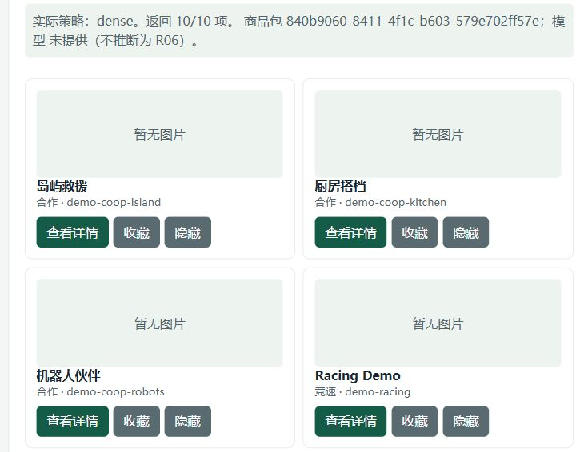
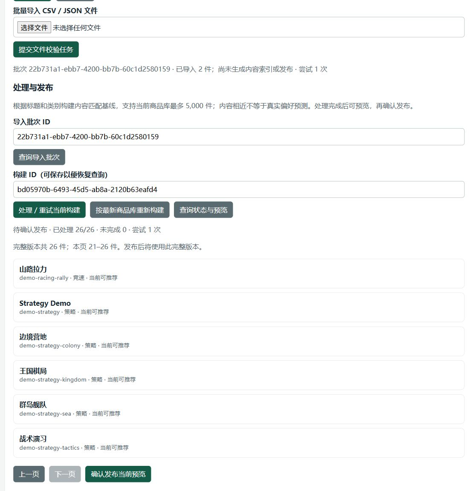
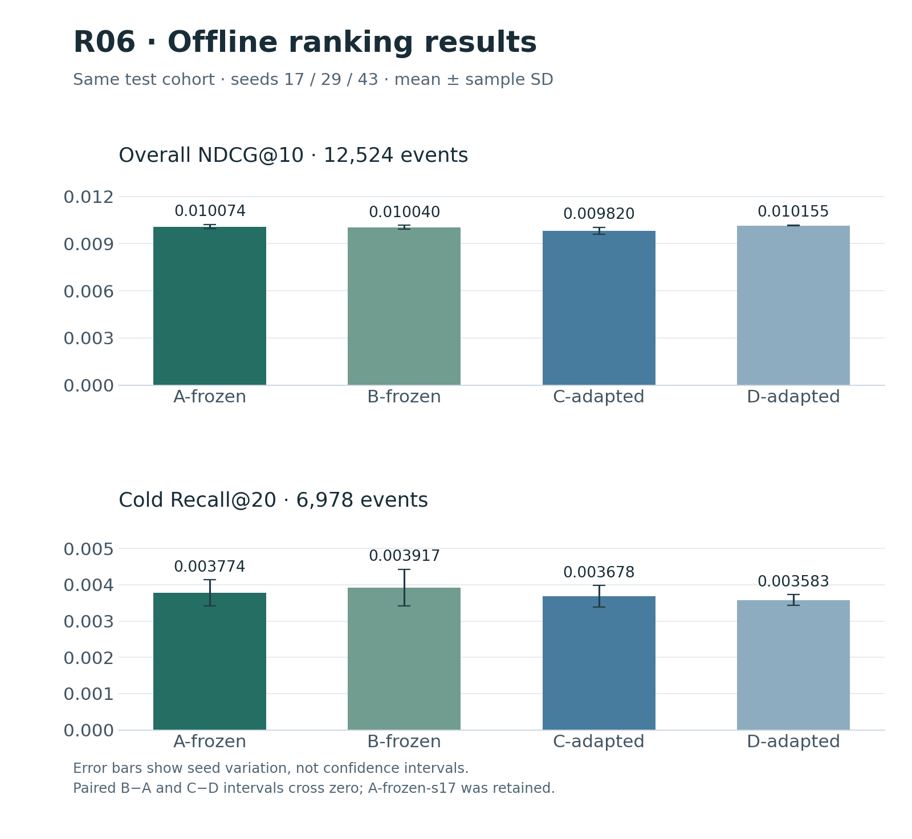

# EvoRec

[简体中文](README.md) | **English**

[](https://github.com/Die4U23/EvoRec/actions/workflows/service-integration.yml)
[](https://github.com/Die4U23/EvoRec/tree/learning-demo-20261014)
[](LICENSE)

A recommendation learning project for cold-start items in a changing catalog, connecting offline retrieval and ranking experiments with a FastAPI service, PostgreSQL persistence, and real failure testing.

The current delivery is a **local recommendation demo plus R01–R06 offline experiments**. The learning version is frozen at [`learning-demo-20261014`](https://github.com/Die4U23/EvoRec/tree/learning-demo-20261014) (`f6e2916`). This does not claim production readiness or completion of the full research PRD.

[Code walkthrough](docs/learning-guide.md) · [Architecture](docs/10-architecture-and-implementation.md) · [Demo setup](ops/demo-quickstart.md) · [R06 report](docs/experiments/r06-multi-interest/report.md)

The linked detailed guides are currently in Chinese; this page provides the English overview and first-run instructions.

## Demo screens

These screens use the local **synthetic catalog content baseline** (24 initial items, 26 after the sample import). They do not show frozen R06 model performance or a recommendation-quality evaluation.



Recommendation page: sample user, results, and feedback controls.



Management page: import, build preview, and explicit publication controls.

[Screenshot provenance and walkthrough checks](docs/validation/readme-walkthrough-20261015.json).

## Core capabilities

- **Recommendation and feedback loop**: sample/new users, item details, favorites, hiding, undo, and session reset; subsequent recommendations use updated history and eligibility filters.
- **Traceable requests**: bind session, catalog bundle, model, and history snapshots to persisted results; replay the original result for the same idempotency key and reject conflicting inputs.
- **Catalog lifecycle**: CSV/JSON import, row-level validation, background builds, preview, explicit publication, deactivation, and rollback.
- **Real model serving**: the approved frozen R06 bundle uses CF + content retrieval and residual ranking. A separate content baseline handles the new-item demo.
- **Execution and recovery controls**: bounded CPU ranking queues, persisted execution ownership, leases, and cancellation cleanup, exercised through restarts, disconnects, and process crashes.
- **Experiment management**: fixed-input strategy comparisons, background jobs, labeled-snapshot evaluation, grouped metrics, and JSON export; research records retain negative findings and uncertainty.

## Architecture

```text
Browser / HTTP client
         |
         v
      FastAPI ---------> Sessions / feedback / catalog management
         |                              |
         v                              v
  Recommend.execute                 PostgreSQL
         |                    Requests, results, versions, jobs
         v                              ^
  Trusted snapshot -> Retrieval / ranking -> Eligibility / Top-K
                            |
                  +---------+----------+
                  v                    v
          New-item baseline         Frozen R06
          Title/category           CF + content + ranker

Background workers: catalog / comparison / evaluation
```

`domain` defines rules, `application` orchestrates use cases, and `infrastructure` adapts the database and models. Offline research lives in `src/evorec/research/`. The [code walkthrough](docs/learning-guide.md) covers call chains, transaction boundaries, and table relationships.

Three design tradeoffs (see the [code walkthrough](docs/learning-guide.md)):

- **Request snapshots** bind session history, catalog eligibility, and model identity at admission so ranking and persistence use the same input; the page may have changed by the time a response arrives.
- **Same-key idempotency** replays a completed result for unchanged input and rejects a changed input, avoiding a silent second computation after an uncertain response.
- **Cancellation drain** waits for background ranking and writes to finish before releasing the execution lease and connection; client waiting can therefore exceed the 2-second API deadline.

## Verified results

### Learning-demo acceptance

These measurements come from local acceptance on **2026-10-14 at `f6e2916`**, not a new benchmark performed for this README update.

| Scenario | Result | Evidence |
| --- | --- | --- |
| Entry-point and dependency regression | 101 service/demo + 4 NumPy checks passed, no failures or skips | [Freeze summary](docs/validation/learning-freeze-20261014.json) |
| Full R06 at concurrency 2 | Two rounds of 120/120 successful requests; zero 504s | [Denominators and configuration](docs/validation/learning-freeze-20261014.json) |
| Recovery and cleanup | Restart, same-key replay, disconnect, crash recovery, and owned PID/port/schema cleanup passed | [Freeze summary](docs/validation/learning-freeze-20261014.json) |
| Browser and shutdown | Fresh catalog browser smoke; full management/R06 browser, Ctrl+C, and backup evidence inherited after source-equivalence review | [Delivery record](docs/validation/learning-delivery-20261013.md) |

The approved bundle contains **137,249 items**, using NumPy 2.1.3, one ranking worker, concurrency 2, and the original 2-second API deadline. Server instrumentation was disabled, with no automatic retries.

| Fixed load round | Success / requests | All-request client p95 |
| --- | ---: | ---: |
| r1 | 120 / 120 | 1,865.940 ms |
| r2 | 120 / 120 | 1,868.645 ms |

Client timing includes connection and transport costs. These results establish only the stated local scenario. Historical intermittent 504s are not fully explained; **300 ms / 20 QPS / long-term SLA targets remain unverified**. CI, browser, and load evidence are recorded separately.

### R06 offline experiments

Four method families share a test cohort of 12,524 positive-feedback events from 9,373 users, with no user overlap with R01–R05. Bars show means across seeds 17/29/43; error bars show sample standard deviations, not confidence intervals.



| Family | Content retrieval / ranker | NDCG@10 mean ± SD | Cold Recall@20 mean |
| --- | --- | ---: | ---: |
| A-frozen | Mean / frozen R05 | 0.010074 ± 0.000129 | 0.003774 |
| B-frozen | Mean + multi-interest / same frozen models | 0.010040 ± 0.000117 | 0.003917 |
| C-adapted | Mean + multi-interest / retrained | 0.009820 ± 0.000216 | 0.003678 |
| D-adapted | Mean / matched retraining control | 0.010155 ± 0.000027 | 0.003583 |

Cold-target candidate coverage rose from **115/6,978** to **122/6,978**, while cold targets without history remained at **0/3,928**. Paired B−A and C−D intervals for overall NDCG and cold Recall both cross zero. The validation rule retained **A-frozen-s17**; the evidence does not support replacing that path. Equal candidate-count budgets also do not imply equal compute costs.

[Full report and paired intervals](docs/experiments/r06-multi-interest/report.md) · [Machine-readable results](docs/experiments/r06-multi-interest/results.json) · [Chart data and provenance](assets/readme/manifest.json)

## Quick start

| Mode | Requirements | What you can observe |
| --- | --- | --- |
| `catalog` | Local database and ordinary `.venv`; built-in synthetic items | Content-baseline recommendations, feedback, import → build → preview → publish; no quality measurement |
| `r06` | Separately prepared approved frozen bundle and `.venv-accelerated` | Real frozen-model recommendations and feedback; arbitrary new items cannot enter the old model, and no catalog management worker starts |

### 1. Prepare the service environment

Requires **Python 3.12** and a reachable local **PostgreSQL 16+** database whose account can create temporary schemas. Run these PowerShell commands from the repository root; skip creation and installation if the environment is already prepared.

```powershell
python -m venv .venv
.\.venv\Scripts\python.exe -m pip install -r requirements-dev.lock.txt
.\.venv\Scripts\python.exe -m pip install --no-deps -e .
.\.venv\Scripts\python.exe -m pip check
if (-not (Test-Path .env)) { Copy-Item .env.example .env }
```

Edit `EVOREC_DATABASE_URL` in `.env` to use your local database connection. Never commit real credentials. Installing the driver does not install PostgreSQL; first-time dependency installation requires network access.

### 2. Start a demo without research models

```powershell
.\.venv\Scripts\python.exe -m scripts.demo catalog --env-file .env --check
.\.venv\Scripts\python.exe -m scripts.demo catalog --env-file .env
```

The first command performs read-only preflight checks. The second creates an isolated temporary schema, 24 synthetic items, and a catalog worker. After `status: ready`, open `/app` at the random local URL printed by the process. Upload fixtures and the temporary management token are in that run's output directory.

For a first visit, use the page controls in this order:

1. Select “示例用户” (sample user) and click “开始体验” (start). Inspect the automatic popular recommendation; select “受控稠密模型” (controlled dense model), click “获取推荐” (get recommendations), and check the actual strategy in the response. Favorite or hide a returned item and request recommendations again to observe the session version and results. Reload to check retained session and feedback state; a change in item order is not an acceptance criterion.
2. Expand “管理操作（本地演示）” (local management), enter this run's temporary token, select `new-items.csv` in the output directory, and click “提交文件校验任务” (submit validation). After import, click “处理／重试当前构建” (build), inspect “查询状态与预览” (status and preview), then click “确认发布当前预览” (publish). Request recommendations again and inspect the active catalog and item eligibility. Import alone does not publish.

Press **Ctrl+C** once and wait for shutdown, or create a `stop` file in the run's output directory. Normal shutdown deletes that run's temporary data. Check `worker_drained` and `owned_schema_removed` in `stopped.json`. Existing services on port 8000 are not touched.

### 3. Run frozen R06 or study the code

Real R06 requires a separately prepared approved model bundle and `.venv-accelerated`; it does not download or train models automatically. After configuring `.env.demo`, run preflight and launch with the same interpreter:

```powershell
.\.venv-accelerated\Scripts\python.exe -m scripts.demo r06 --env-file .env.demo --check
.\.venv-accelerated\Scripts\python.exe -m scripts.demo r06 --env-file .env.demo
```

See the [unified demo guide](ops/demo-quickstart.md) for configuration fields and bundle checks. Raw data, models, and per-request traces are not distributed through Git.

[Code walkthrough](docs/learning-guide.md) · [Ordinary service, migrations, and workers](ops/service-reference.md) · [Research setup and reproduction](research/README.md)

## Main interfaces

| Endpoint | Purpose |
| --- | --- |
| `GET /health/live`, `GET /health/ready` | Distinguish process liveness from controlled-runtime readiness |
| `GET /api/v1/system` | Inspect the actual version, serving path, and capability flags |
| `/api/v1/sessions` | Create, retrieve, and reset token-protected sessions |
| `POST /api/v1/recommendations` | Execute against a captured snapshot with UUID idempotency keys |
| `POST /api/v1/feedback` | Record views, favorites, and hiding for actually returned items |
| `/api/v1/admin/` | Local token-protected import, build, publish, deactivate, and rollback |
| `/app`, `/app/results`, `/app/evaluations` | Recommendation demo, experiment results, and labeled-snapshot evaluation |

See the running service's `/openapi.json` and [API contracts](docs/contracts/README.md) for full parameters. Background comparison/evaluation jobs require their respective workers; starting the API alone does not consume these queues.

## Validation layers

- **Unit and contract checks**: input validation, candidate eligibility, idempotency, session versions, and architectural boundaries.
- **PostgreSQL integration**: transactions, publication recovery, execution ownership, and leases; isolated temporary schemas, with a missing database treated as a failure rather than a skip.
- **Real TCP and browser flows**: feedback, catalog lifecycle, page reloads, and shutdown behavior.
- **Frozen-model and fault tests**: full bundles, fixed load denominators, durable state, disconnects, and actual process crashes.
- **Offline research audits**: candidate, feature, and model-output replay; grouped metrics and paired user-cluster intervals.

Commands and environments are documented in the [CI workflow](.github/workflows/service-integration.yml), [validation index](docs/validation/README.md), and [research guide](research/README.md). Rebuild these README charts with `python scripts/build_readme_figures.py` in the research environment; no training is required.

## Current limits

- Single-instance, trusted local use; no public identity system, multi-node high availability, or validated container deployment.
- R06 resolves `adaptive` to `dense`. Generative retrieval, TIGER/LIGER reproduction, and learned budget routing are not implemented; `cpp/` has no implementation.
- Arbitrary new items belong to the separate content baseline, capped at 5,000 items; they cannot enter frozen R06's existing vocabulary and weights directly.
- Clean-machine and full-model Linux reproduction, long-running open-arrival load, and PRD performance targets remain unverified.
- Remaining UI requirements include retaining old results on timeout, visibility-based exposure reporting, deactivation notices in details, interest-category selection, and a complete metrics dashboard.
- Experiments use static item metadata without historical content versions; there is no online CTR or business-gain evidence. Further tuning requires a new protocol rather than reusing an already inspected test set.

## Repository map

```text
src/evorec/api/             FastAPI and HTTP contract adapters
src/evorec/application/     Recommendation orchestration and ports
src/evorec/domain/          Snapshots, eligibility, and domain rules
src/evorec/infrastructure/  PostgreSQL, runtimes, and job adapters
src/evorec/research/        Data, training, retrieval, ranking, evaluation
db/migrations/             Formal database migrations
web/                       Local pages without a build step
tests/                     Unit, database, browser-script, and fault checks
research/                  Experiment configs, dependencies, run guides
docs/experiments/          R01–R06 protocols, results, and figures
docs/validation/           Acceptance summaries and independent checks
scripts/                   Runtime, diagnostics, audits, and charts
```

Further reading: [Documentation map](docs/README.md) · [Experiment index](docs/experiments/README.md) · [Project status](docs/STATUS.md) · [Current demo scope](docs/product/demo-scope.md)

## Next steps

1. Use the frozen version to learn the call chain, transactions, idempotency, retrieval, and ranking, then make an independent scoped change.
2. Address existing UI gaps and repeatable diagnostics while retaining performance failures and measurement conditions.
3. Pursue no-history cold targets, a second domain, and generative/budget-routing research separately; planned work is not presented as implemented.

## Provenance and license

Author: **Die4U23**.

Code is licensed under the [MIT License](LICENSE). See the [data notes](datasets/README.md) for data sources and boundaries, and the [experiment index](docs/experiments/README.md) for methods and reproduction references.
