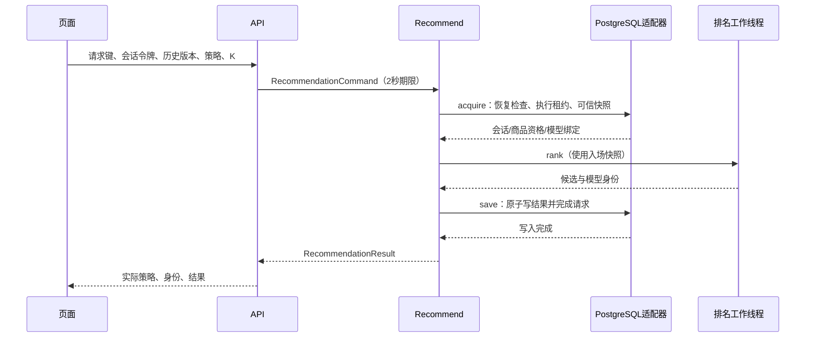

# EvoRec 学习版代码导读

先用已经收尾的本地工程理解系统，再练习修改。工程完成情况看[交付记录](validation/learning-delivery-20261013.md)，启动只看[统一快速指南](../ops/demo-quickstart.md)。历史计划与实验记录用于解释决策，不必从头读完才运行。

当前学习范围是单机 PostgreSQL 推荐 Demo：商品内容基线支持新品导入、构建和发布；冻结 R06 使用批准的 137,249 件商品及 NumPy 模型。二者共享请求、会话、反馈和持久化协议，但不能把内容基线的新商品直接塞进冻结 R06。模型和原始数据不随 Git 分发；没有批准模型时，先运行 catalog 即可学习工程链路。

## 先找到代码

| 目录或文件 | 负责什么 | 第一遍读什么 |
| --- | --- | --- |
| [scripts/demo.py](../scripts/demo.py) | 统一配置、来源校验、只读预检和启动 | `settings` → `preflight` → `dispatch` |
| [scripts/run_catalog_demo.py](../scripts/run_catalog_demo.py)、[run_r06_demo.py](../scripts/run_r06_demo.py) | 隔离 schema、模型准备、监听及退出 | `run` 的 try/finally；catalog 的 `serve_catalog` |
| [web/index.html](../web/index.html) 与 [web](../web) | 页面和会话操作 | 从界面按钮追到 `/api/v1/recommendations` 和反馈请求 |
| [api/app.py](../src/evorec/api/app.py) | HTTP 输入、身份、错误码、输出 | `recommend`，不要先读所有管理路由 |
| [application/recommend.py](../src/evorec/application/recommend.py) | 与数据库细节无关的业务编排 | `Recommend.execute` 全文 |
| [domain/recommendation.py](../src/evorec/domain/recommendation.py) | 推荐结果合法性与 Top-K | `select_results`；配合 [models.py](../src/evorec/domain/models.py) 理解快照 |
| [infrastructure/postgres.py](../src/evorec/infrastructure/postgres.py) | 会话、请求、反馈、结果持久化 | `acquire`、`_admit_transaction`、`_mark_failed`、`_save` |
| [recommendation_execution.py](../src/evorec/infrastructure/recommendation_execution.py) | 同键执行归属与连接生命周期 | `admit`、`result_connection`、`close` |
| [r06_serving.py](../src/evorec/infrastructure/r06_serving.py)、[r06_async.py](../src/evorec/infrastructure/r06_async.py) | 冻结模型排序与有界 CPU 工作 | 排序上下文绑定、排队及取消后的 drain |
| [db/migrations](../db/migrations) | 真正执行的数据库结构演进 | 0001、0002、0009、0010、0011，再按功能看其他迁移 |
| [tests](../tests)、[scripts](../scripts) | 功能回归及独立验收 | 先读本次 [Ctrl+C 回归](../tests/test_catalog_demo.py)，再看生命周期测试 |

`bootstrap.py` 负责把端口接口接到具体后端。研究代码在 `src/evorec/research/`，训练配置与运行方法在 `research/`；日常服务不在每次请求中重新训练。

## 一次推荐怎样完成



1. 页面保持同一次操作的幂等键，API 把输入转换为命令。令牌校验失败不会执行推荐。
2. 入场读取历史版本与当前活动 bundle，固定请求快照。相同键已有完成结果时重放；同键输入变化时拒绝。
3. 排序只能使用绑定的快照。R06 会校验模型、成员、文本、时间和资格；SQL 捕获优化减少全量行搬到 Python 的成本，仍核对真实数据。
4. `Recommend.execute` 再核对绑定、模型身份和回退说明，并过滤合法结果。结果写入和请求 `completed` 在同一事务中完成。
5. 请求取消时，后台线程不因 Python await 被取消就立刻停止。入场、排序、写入和失败清理需要实际结束，才能释放租约与连接。`_mark_failed` 同时核对请求 ID、执行 owner 和 `accepted` 状态，防止旧执行者污染新归属或已完成结果。

`result_connection` 复用仍由执行者持有的连接，同时检查连接、autocommit 和事务终态；它不是额外连接池，也不能把提交失败当成功。服务 2 秒期限涵盖编排，但取消清退可能让客户端等待超过 2 秒。客户端总耗时还包含连接与传输。

## 表关系与事务

| 表组 | 关系及事务边界 |
| --- | --- |
| `sessions` → `recommendation_requests` → `request_items` | 会话有多次请求；每个请求商品和名次分别唯一。请求保存 epoch、history_version、bundle、屏蔽及模型快照；结果和 completed 原子提交。0011 增加 `execution_owner`；活性还要看执行锁，不能只看这个字段。 |
| `feedback_events` → `request_items`；`session_item_states` → `sessions/items` | 反馈必须引用本会话真实返回的商品。按 event_id 和载荷哈希去重；事件、派生曝光与状态更新在同一事务内。收藏/隐藏使用设置 true/false，重复提交不会反向切换。 |
| `bundle_versions` → `bundle_items` → `items`；`catalog_control` | 成员记录固定包与商品关系；活动包与 exclusion_version 分开管理。回滚改变活动包，不恢复已下架商品。发布须协调数据库与内存运行时，数据库外键不能替代发布协议。 |
| `catalog_imports`、`catalog_file_jobs`、`catalog_builds`、`publication_operations` | 入库、后台构建、预览、显式发布是不同状态。文件解析错误整批拒绝；发布操作记录目标和前置活动版本，用于幂等与恢复。 |
| `strategy_comparisons`、`strategy_comparison_jobs`、`evaluation_jobs` | 扩展的对比和标注快照评估记录。独立 worker 执行；统一基础 Demo 不启动这些 worker，不能期待所有后台任务自动运行。 |

重置在事务内增加 epoch 和历史版本，清空收藏/隐藏并恢复固定演示历史。已入场旧请求可能完成其旧快照；页面必须丢弃迟到的旧会话结果，旧 epoch 的新反馈也被拒绝。不是删除历史推荐记录来实现重置。

完整字段以[正式迁移](../db/migrations)和[接口契约](contracts/README.md)为准；[数据设计](03-data-design.md)保留早期背景，不能把其中历史“待实现”当成当前结论。

## 出错时从哪里查

先保存时间、HTTP 状态、错误 `code`、`request_id`、会话版本、实际 bundle/model；不要记录令牌或 DSN。成功响应也需保存身份，不只保留 200。

| 现象 | 排查与重试规则 |
| --- | --- |
| `database_not_configured` / `dependencies_missing` / `evorec_source_mismatch` | 先运行统一入口 `--check`，核对配置文件、解释器与当前 checkout。不要修改共享环境掩盖来源不一致。 |
| 401 `session_access_denied` | 令牌缺失或不属于该会话；管理员令牌不能当会话令牌。 |
| 409 `history_conflict` | 读取当前会话状态后发起新的用户操作；不要把已改变的输入塞回旧幂等键。 |
| 409 `recommendation_in_progress` | 同键仍在执行；保留原键查询/重试，不制造重复工作。 |
| 409 `recommendation_idempotency_conflict` | 同一键对应了不同输入；先检查调用方操作边界。 |
| 429 | 有界容量或任务限额已满；读取具体 code，等待容量释放，不能当推荐成功。 |
| 503 `database_unavailable` / `catalog_unavailable` | 检查本轮数据库和发布 readiness；重试要遵守响应的 retryable 及原键规则。 |
| 504 `recommendation_timeout` | 本项目 API 捕获 2 秒期限产生的超时，未必来自代理。保存请求键，核对持久终态和结果行，不能直接判断为 SQL、CPU 或 GIL。原键若已 failed，后续可能返回不可重试终态；需要新计算时明确作为新操作。 |

现有诊断能够用 request_id 串起 HTTP、执行 owner、终态、结果行、租约与阶段；阶段明细来自显式启用的隔离探针，普通服务不会自动保存同等精度的全链路 trace。数据库 `timings` 字段存在也不代表每条记录都包含阶段数据。这个边界足以支撑当前本地排障，不宣称生产监控完备。

需要定位新超时时，在干净提交上、独立终端载入本机 `EVOREC_DATABASE_URL`，使用全新输出目录：

```powershell
# 以下尖括号替换为已核对的批准包身份；不要直接复制占位符运行。
python -m scripts.profile_r06_tcp <新输出目录> <批准根目录> <bundle-UUID> --expected-manifest-sha256 <批准SHA256> --samples 24 --concurrency 2 --no-gc-events
# 同配置无插桩对照另开新目录，在上述参数后加 --untraced。
```

解释器须为当前 checkout 的 NumPy 环境。读 `profile.json` 的全部样本分母、失败与完整性，再按 request_id 看阶段。不要相加嵌套阶段；SQL/驱动阶段包括等待、接收等成本。诊断退出 0 不表示负载通过。正式限定负载使用 `scripts.verify_r06_reliability --strict-load`，具体固定配置见[双轮报告](validation/r06-lifecycle-frozen-20261012.md)。不要在已有报告上覆盖输出或自动重试失败样本。

历史记录曾定位一笔 504 在结果写入新连接阶段触发期限；这不能解释所有旧失败。修复版本两轮各 120/120 是指定场景的证据，不能推导 20 QPS、长期稳定性或全体旧 504 的唯一根因。

## 后续学习与面试讲述

建议按三次阅读推进：先运行 catalog，能画出一次请求的调用链；再理解数据库事务和原键重放；最后看冻结 R06 的召回、排序与研究报告。每次只改一个小点并运行相应测试，练习发生在工程交付之后。

| 问题 | 应能讲出的要点 |
| --- | --- |
| 为什么分召回与排序？ | 召回缩小候选集合，排序在候选内比较；候选没进池，排序无法补救。 |
| 为什么有 epoch 又有 history_version？ | epoch 区分重置前后会话代数，version 检测当前历史/反馈变化；旧快照与新界面不能混用。 |
| 为什么超时后不能直接重发新键？ | 服务可能已经写入或仍在清退；原键和账本决定是否重放、等待或终态失败。 |
| 为什么取消后还要等线程？ | await 的取消不终止后台线程；提前释放租约会让别的执行者与旧工作同时修改状态。 |
| 为什么入库和发布分开？ | 入库只说明文本合法；还需构建完整索引、校验兼容性，再切换活动版本。 |
| 回滚为什么不恢复商品？ | 版本选择和商品下架是独立语义；回滚不能撤销运营排除。 |
| 如何证明优化有效？ | 固定提交、配置和分母，关闭插桩做对照，再检查终态/恢复；功能通过、CI 通过与负载验收分别报告。 |
| R06 有没有取得线上提升？ | 没有线上收益证据；离线区间与负结果照实讲，冻结模型也不支持任意新品。 |

项目方向与取舍由作者主导，实现、测试和文档使用 AI 辅助。当前工程验证由 AI 执行；作者的理解、独立修改和现场讲述另行记录，不把这些写成已经独立完成，也不因尚未学习而阻塞工程交付。
